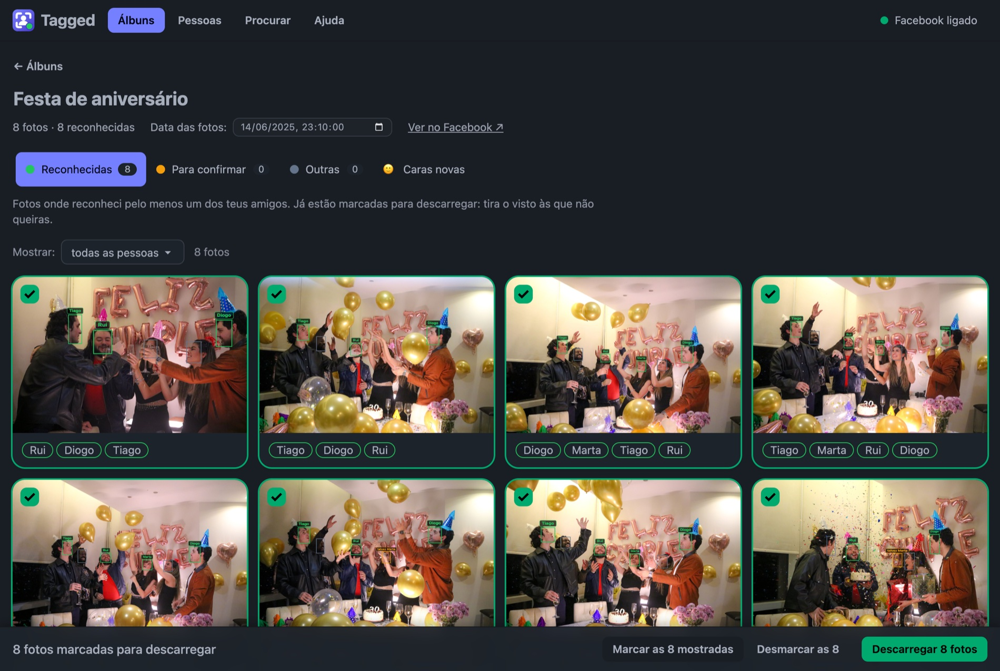
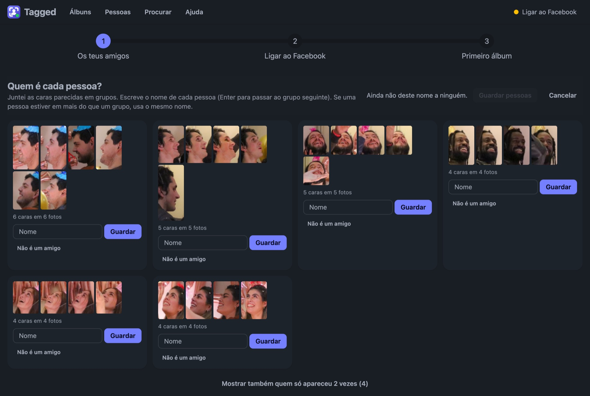
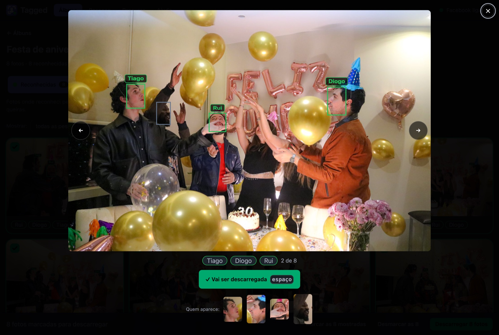
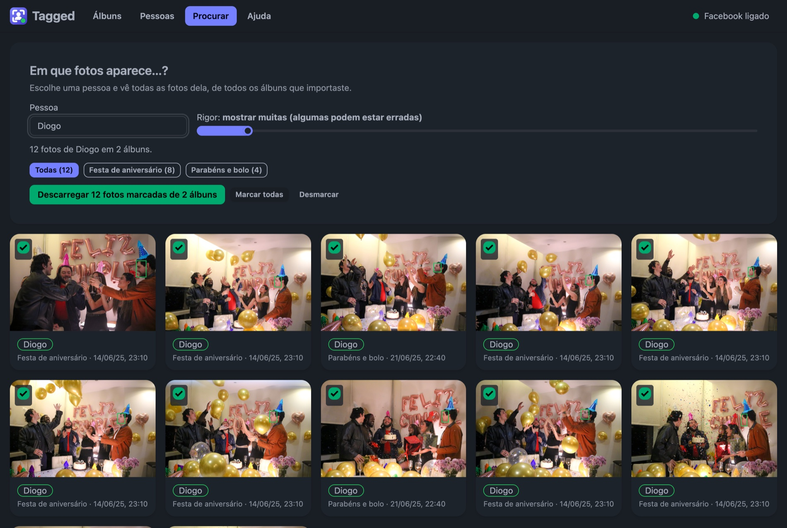

<p align="center"></p>

# tagged

Find the photos of you and your friends in a whole Facebook album.



## Why

I built this out of laziness. My university's student association posted a Facebook album for every event, and I kept losing hours opening them one by one to find the photos where my friends and I appear. Now I open an album, click a button, and Tagged sorts the photos for me: the ones with my friends come pre-selected, the doubtful ones are set aside for me to decide, and I download only those.

## What it does

1. **Imports the album.** A Chrome extension scrolls through the album you have open on Facebook and brings the photos in.
2. **Recognises people.** It compares the faces with your friends' and sorts the photos into _Reconhecidas_ (recognised), _Para confirmar_ (to confirm) and _Outras_ (others).
3. **Downloads what matters.** A `.zip` with the originals (`Name_0001.jpg`…) and the album date written to EXIF, or a new Google Photos album.

You can also **search for one person across every album** you have imported.

## How to use it

**First, teach it who your friends are** (once). Pick a folder with photos of them, Tagged groups similar faces together, and you say who each group is. It also accepts a `people.npz` file from a previous run.



**Then, for each album:**

1. Open the album on Facebook, go back to Tagged and click **Importar álbum do Facebook** (Import Facebook album). It scrolls by itself, at a human pace.
2. Review. _Reconhecidas_ come pre-selected; in _Para confirmar_ you decide (`P` includes, `X` leaves out, `?` lists every shortcut). If a face wasn't recognised, click it and say who it is: Tagged learns and updates your albums.
3. Click **Descarregar N fotos** (Download N photos). It fetches the full-quality photos from Facebook and hands them over as a zip.





## Install

### With Docker (simplest)

```bash
mkdir tagged && cd tagged
curl -O https://raw.githubusercontent.com/mpoboas/tagged/main/docker-compose.yml
TAGGED_PASSWORD='a-password' docker compose up -d
```

Open `http://<server>:8768` (user `tagged`). The first time, it downloads the InsightFace models (~280 MB); the page tells you while it isn't ready.

<details>
<summary>More about Docker</summary>

- **Password:** set `TAGGED_PASSWORD` whenever the server is reachable from outside your computer. Without it, anyone who reaches the port can use the tool.
- **Hostnames:** without a password, the server only accepts requests made by IP or `localhost` (DNS rebinding protection). If you open it by name (`nas.local`), add it to `TAGGED_ALLOWED_HOSTS` (comma-separated) or set a password.
- **HTTPS:** put it behind a reverse proxy (Caddy, Traefik, nginx) if you expose it to the internet. The extension you download from the page is already set up for the address you opened it with.
- **Image:** `ghcr.io/mpoboas/tagged:latest` (amd64 and arm64). It does not include the models (non-commercial research licence); they live in the `data/models` volume. If the package is private, run `docker login ghcr.io` or make it public on GitHub.
- **Volume permissions:** the container runs as user 1000. If yours is different, `chown -R 1000 data` or add `user: "<uid>:<gid>"` to the compose file.

</details>

### On your computer

Double-click `start.command` (macOS) or `start.bat` (Windows). On the first run it installs what is missing, starts the server and opens Tagged in your browser. The server only runs while the window is open.

macOS is much faster (it uses the Apple chip, ~0.07 s per photo versus 1–5 s on CPU only) and needs `xcode-select --install` and `uv`, which the script offers to install. Windows is untested; if the install fails, `start.bat` falls back to Docker Desktop.

<details>
<summary>Autostart, port and command line</summary>

- **Start at login:** `scripts/autostart-install.command` (macOS) or `scripts\autostart-install.bat` (Windows); the matching `autostart-remove` undoes it. Neither needs administrator rights.
- **Port:** `TAGGED_PORT=9000` (default 8768).
- **By hand:** `cd backend && uv sync && uv run tagged serve`, then open `http://127.0.0.1:8768`.
- **People from the command line** (the page does the same thing):

  ```bash
  cd backend && uv sync
  uv run tagged cluster --photos ../data/raw   # group the faces in the photos you have
  uv run tagged label                          # name each group and export data/people.npz
  uv run tagged eval                           # precision/recall per threshold, with photos at Facebook-thumbnail size
  ```

</details>

### The Chrome extension

The page walks you through it on first use (the **Ligar ao Facebook** / Connect to Facebook step, and later under **Ajuda** / Help): download the zip, unzip it, open `chrome://extensions`, turn on _Developer mode_ and load the folder with _Load unpacked_. The page detects it on its own and the indicator in the corner changes to "Facebook ligado" (Facebook connected).

## Privacy

- **People stay in your browser**, not on the server. The server only returns each photo's faces and vectors, and the comparison happens in the browser. It stores nothing.
- The vectors of your friends' faces are biometric data: don't publish them or bake them into the Docker image. The `data/` folder is in `.gitignore`.
- The extension only starts when you click, only touches the album you have open, and stores no credentials.

## Heads-up

- The InsightFace models are **for non-commercial research only**; the code is MIT. Personal use is fine.
- Automating Facebook goes against Meta's terms. The extension works at a human pace, but there is a risk to your account.
